# 🌐 CyberMP Freeroam

[](LICENSE)
[](https://github.com/cyber-mp/cybermp-freeroam/pkgs/container/freeroam)
[](https://nodejs.org/)
[](https://pnpm.io/)
[](https://www.typescriptlang.org/)

**CyberMP Freeroam** is an official, open-source multiplayer gamemode built for the **[CyberMP](https://github.com/cyber-mp)** platform (Cyberpunk 2077 Multiplayer). Built as a high-performance, modular TypeScript monorepo, it delivers an expansive sandbox experience featuring real-time client-server synchronization, interactive CEF browser interfaces, matchmaking arenas, vehicle management, and administration tools.

---

## 📑 Table of Contents

- [Features](#-features)
- [Architecture & Tech Stack](#-architecture--tech-stack)
- [Project Structure](#-project-structure)
- [Prerequisites](#-prerequisites)
- [Local Development Setup](#-local-development-setup)
  - [1. Clone & Install](#1-clone--install)
  - [2. Environment Configuration](#2-environment-configuration)
  - [3. Running Development Server](#3-running-development-server)
  - [4. Development with Docker](#4-development-with-docker)
  - [Development Scripts Reference](#development-scripts-reference)
- [Production Deployment (`ghcr.io/cyber-mp/freeroam`)](#-production-deployment-ghcricyber-mpfreeroam)
  - [Overview](#overview)
  - [Network & Port Requirements](#network--port-requirements)
  - [Option A: Deploy via Docker Compose (Recommended)](#option-a-deploy-via-docker-compose-recommended)
  - [Option B: Deploy via Docker CLI](#option-b-deploy-via-docker-cli)
  - [Configuration & Environment Variables](#configuration--environment-variables)
  - [Customizing `server.toml`](#customizing-servertoml)
  - [Logging & Maintenance](#logging--maintenance)
  - [Updating the Container](#updating-the-container)
- [In-Game Commands & Administration](#-in-game-commands--administration)
- [Code Quality & Git Hooks](#-code-quality--git-hooks)
- [License](#-license)

---

## ✨ Features

- **🎮 Seamless Sandbox Gameplay:**
  - Real-time vehicle spawning, customization, and vehicle nitro boost.
  - Teleportation to key Night City districts and custom spawn positions.
  - Safe zones / Greenzones with weapon and damage restrictions.
  - Real-time synchronized weather, day/night cycle, and time controls.
  - Godmode, noclip, and spectating support.
  - In-world 3D navigation, entity nametags, and player markers.
- **⚔️ Matchmaking & Custom Arenas:**
  - Integrated matchmaking lobby and game modes (including custom map conversions such as `de_dust2`).
  - Killfeed, round tracking, and scoreboard integration.
- **🖥️ Reactive In-Game CEF Browser UI:**
  - Built with React 19, TanStack Router, and Tailwind CSS.
  - Cyberpunk-styled HUD, interactive menus, chat box, and notifications.
- **🛡️ Administration & Moderation:**
  - Password-protected admin role with elevated commands (`/admin`, `/kick`, `/ban`).
  - Dynamic permission system based on CASL abilities.
- **🔄 Hotreloading:**
  - Live server resource reloading during development without restarting the server binary.

---

## 🏗️ Architecture & Tech Stack

```mermaid
flowchart LR
    subgraph Browser ["CEF Browser UI (React 19)"]
        UI[HUD & Menus]
        TR[TanStack Router]
        BRPC[RPC Browser Client]
    end

    subgraph Client ["Game Client (TypeScript)"]
        C_INV[Inversify Container]
        C_MOD[Client Modules]
        CRPC[RPC Client Router]
    end

    subgraph Server ["CyberMP Server (TypeScript + Native Engine)"]
        S_INV[Inversify Container]
        S_MOD[Server Services & Controllers]
        SRPC[RPC Server Router]
        DB[(Server Memory & States)]
    end

    Browser <-->|RPC Events| Client
    Client <-->|RPC Network Sync| Server
```



- **Runtime & Package Manager:** Node.js v22+ with `pnpm` workspaces.
- **Dependency Injection:** [InversifyJS](https://inversify.io/) provides strict decoupling across controllers, services, and repositories on both client and server.
- **Type-Safe RPC Framework:** All communication across **Browser ↔ Client ↔ Server** is schema-validated and typed using `@cybermp/rpc-*`.
- **Bundlers:** [tsdown](https://github.com/sxzz/tsdown) (powered by Rolldown/esbuild) for high-speed client/server bundling; [Vite](https://vite.dev/) for the CEF Browser UI.
- **Linter & Formatter:** [Biome](https://biomejs.dev/) ensures consistent and lightning-fast code analysis.

---

## 📂 Project Structure

```text
cybermp-freeroam/
├── docker-compose.yml       # Production build-from-source compose file
├── docker-compose.prod.yml  # Production compose file using GHCR prebuilt image
├── docker-compose.dev.yml   # Development container compose file
├── Dockerfile               # Multi-stage container build definition
├── server.toml              # CyberMP server configuration (ports, core flags, resources)
├── pnpm-workspace.yaml      # Monorepo workspace configuration
├── package.json             # Root dependencies and lifecycle scripts
├── libs/                    # Shared workspace libraries
│   ├── inversify/           # Custom Inversify helpers and decorators
│   └── shared/              # Shared types, Zod schemas, matchmaking definitions
├── mp/                      # CyberMP native server binaries
│   ├── linux/               # Linux native binary (`cybermp-server`)
│   └── win/                 # Windows native binary (`cybermp-server.exe`)
└── resources/               # CyberMP server resources
    ├── freeroam/            # Main freeroam resource
    │   ├── assets/          # Archives and custom maps (e.g. de_dust2, navigation)
    │   ├── browser/         # In-game React/CEF user interface
    │   ├── client/          # Client-side scripts (Inversify)
    │   ├── server/          # Server-side scripts (Inversify)
    │   └── resource.toml    # Freeroam resource manifest
    └── hotreload/           # Development live-reload resource
```

---

## 🛠️ Prerequisites

Before you start, ensure you have the following installed on your host system:

- **Node.js:** `v22.0.0` or higher
- **pnpm:** `^11.8.0` (install via `npm install -g pnpm` or `corepack enable`)
- **Git**
- **Docker & Docker Compose** *(required for containerized environments and production)*

---

## ⚙️ Local Development Setup

### 1. Clone & Install

Clone the repository and install all monorepo dependencies:

```bash
git clone https://github.com/cyber-mp/cybermp-freeroam.git
cd cybermp-freeroam
pnpm install
```

### 2. Environment Configuration

Copy the example environment file:

```bash
cp .env.example .env
```

Open `.env` and set your preferred admin password:

```env
ADMIN_PASSWORD=your_super_secret_admin_password
PORT=2077
```

### 3. Running Development Server

Running the development environment locally requires **two terminal windows**:

#### **Terminal 1: Watch & Compile Resources**
Watches TypeScript changes across all workspace packages and compiles them in real-time:
```bash
pnpm run dev:build
```

#### **Terminal 2: Start Native CyberMP Executable**
Launch the server executable according to your operating system:
- **Linux:**
  ```bash
  pnpm run dev:linux
  ```
- **Windows:**
  ```bash
  pnpm run dev:win
  ```

> [!NOTE]
> Ensure the native binaries in `mp/linux/cybermp-server` or `mp/win/cybermp-server.exe` have execution permissions on your machine (`chmod +x mp/linux/cybermp-server`).

### 4. Development with Docker

If you prefer running the server binary inside Docker while editing source files on your host machine:

```bash
pnpm run dev:docker
```
This mounts your local `./resources` and `./server.toml` into a container running `ghcr.io/cyber-mp/server:latest`.

### Development Scripts Reference

| Script | Command | Description |
| :--- | :--- | :--- |
| `pnpm run dev:build` | `pnpm run -r --parallel --filter @freeroam/* dev` | Starts watch-compilation for client, server, and browser |
| `pnpm run build` | `pnpm run -r --filter @freeroam/* build` | Builds all packages for production |
| `pnpm run dev:linux` | `./mp/linux/cybermp-server -run -rdir=$(pwd)/resources` | Launches Linux native binary in development mode |
| `pnpm run dev:win` | `./mp/win/cybermp-server.exe -run -rdir=./resources` | Launches Windows native binary in development mode |
| `pnpm run type:check` | `pnpm run -r --filter @freeroam/* type:check` | Runs TypeScript type-checking across all packages |
| `pnpm run biome:check` | `biome check --write ./resources` | Lints and formats all code via Biome |

---

## 🚀 Production Deployment (`ghcr.io/cyber-mp/freeroam`)

The official production Docker image **`ghcr.io/cyber-mp/freeroam:latest`** contains:
1. The native CyberMP server runtime.
2. Production-compiled JavaScript bundles for `@freeroam/server` and `@freeroam/client`.
3. Production-optimized static assets for the React CEF Browser UI.
4. Default server configuration and game asset archives.

### Network & Port Requirements

CyberMP requires the following ports open on your host / firewall:

| Port | Protocol | Purpose |
| :--- | :--- | :--- |
| **`2077`** | **TCP** | Game connection handshake, HTTP asset download, CEF browser RPC |
| **`2077`** | **UDP** | High-speed player positioning, combat, sync packets, and voice stream |

> [!IMPORTANT]
> Both **TCP and UDP** must be exposed and forwarded to the container on the same port number.

---

### Option A: Deploy via Docker Compose (Recommended)

This repository includes a production compose file: [`docker-compose.prod.yml`](docker-compose.prod.yml).

#### 1. Setup Deployment Directory
On your production host server, create a dedicated folder and prepare configuration:

```bash
mkdir -p /opt/cybermp-freeroam
cd /opt/cybermp-freeroam
```

#### 2. Create `.env`
```bash
cat <<EOF > .env
PORT=2077
ADMIN_PASSWORD=change_this_to_a_secure_password
NODE_ENV=production
IS_DOCKER=true
EOF
```

#### 3. Create `docker-compose.yml`
Save the following configuration as `docker-compose.yml`:

```yaml
services:
  freeroam:
    image: ghcr.io/cyber-mp/freeroam:latest
    container_name: cybermp-freeroam
    restart: unless-stopped
    env_file: .env
    environment:
      NODE_ENV: production
      IS_DOCKER: "true"
    stdin_open: true
    tty: true
    ports:
      - "${PORT:-2077}:2077/tcp"
      - "${PORT:-2077}:2077/udp"
    volumes:
      - ./cache:/cybermp/cache
      - ./crashdumps:/cybermp/crashdumps
      - ./logs:/cybermp/logs
      # Optional: Uncomment if you want to override server.toml
      # - ./server.toml:/cybermp/server.toml:ro

volumes:
  cache:
  crashdumps:
```

#### 4. Prepare Host Directories & Permissions
```bash
mkdir -p cache crashdumps logs
```

#### 5. Launch the Server
```bash
docker compose up -d
```

Verify that the container is healthy and running:
```bash
docker compose ps
docker compose logs -f
```

---

### Option B: Deploy via Docker CLI

If you prefer launching the container directly with Docker CLI:

```bash
# 1. Create directories for data persistence
mkdir -p $(pwd)/data/cache $(pwd)/data/crashdumps $(pwd)/data/logs

# 2. Run container
docker run -d \
  --name cybermp-freeroam \
  --restart unless-stopped \
  -p 2077:2077/tcp \
  -p 2077:2077/udp \
  -e NODE_ENV=production \
  -e IS_DOCKER=true \
  -e ADMIN_PASSWORD="your_secure_password_here" \
  -v $(pwd)/data/cache:/cybermp/cache \
  -v $(pwd)/data/crashdumps:/cybermp/crashdumps \
  -v $(pwd)/data/logs:/cybermp/logs \
  ghcr.io/cyber-mp/freeroam:latest
```

---

### Configuration & Environment Variables

| Variable | Default | Description |
| :--- | :--- | :--- |
| `ADMIN_PASSWORD` | *(None)* | Secret passphrase used by administrators in-game via `/admin <password>` |
| `NODE_ENV` | `production` | Set to `production` for optimized runtime behavior |
| `IS_DOCKER` | `true` | Informs scripts that the process is running inside containerized environment |
| `PORT` | `2077` | The external port mapped to the server's TCP/UDP listener |

---

### Customizing `server.toml`

The Docker image contains a pre-configured `server.toml`. If you want to modify settings (e.g. `max_players`, server name, core gameplay overrides), export or create a local `server.toml` and mount it into `/cybermp/server.toml`:

```toml
#:schema https://schemas.cyber.mp/server/schema.json

tcp_host = "0.0.0.0:2077"
udp_host = "0.0.0.0:2077"

max_players = 2500
disable_voice = false
resources = ["freeroam"] # Note: omit 'hotreload' in production
cef_debug = false

[core]
nametags = true
disable_switch_seats = true
delete_map_objects = true
default_gameplay_restrictions = true
disable_drop_points = true
disable_location_dependent_quests = true
disable_garage = true
files = [
  "final.redscript",
  "new_gamedef.archive",
  "basegame_no_intro_videos.archive",
  "CyberMP_PlayerModel.archive",
  "flatline2dlods.archive",
  "ReducedLoot.archive",
  "ReducedLoot.archive.xl",
  "GenderAbuseWorld.archive",
  "ArchiveXL"
]

[core.overrides]
change_player_on_death_logic = true
disable_side_quests_notifications = true
change_vehicles_logic = true
disable_player_inventory_encumbrance = true
player_extended_customization = true
disable_time_skip = true
disable_turrets = true
disable_surveillance_cameras = true
disable_vending_machines = true
disable_generic_devices = true
disable_no_combat = true
```

Mount it in your `docker-compose.yml`:
```yaml
volumes:
  - ./server.toml:/cybermp/server.toml:ro
```

> [!TIP]
> In production environments, remove `"hotreload"` from the `resources` array in `server.toml` to reduce filesystem polling overhead.

---

### Logging & Maintenance

#### View Live Server Logs
```bash
# Docker Compose
docker compose logs -f --tail=100

# Docker CLI
docker logs -f --tail=100 cybermp-freeroam
```

#### Access Interactive Server Console
The container runs with `stdin_open: true` and `tty: true`. You can attach to the server interactive terminal:
```bash
docker attach cybermp-freeroam
```
*(To detach without stopping the container, press `Ctrl+P` followed by `Ctrl+Q`)*.

---

### Updating the Container

To update to the latest release of `cybermp-freeroam`:

```bash
docker compose pull
docker compose up -d --force-recreate
```

Or prune old images after updating:
```bash
docker image prune -f
```

---

## 💬 In-Game Commands & Administration

Players and admins can type commands directly into the in-game chat:

### Player Commands
| Command | Arguments | Description |
| :--- | :--- | :--- |
| `/help` | — | Displays all available commands |
| `/veh` | `<vehicle_model>` | Spawns a vehicle by model name |
| `/dv` | — | Deletes currently spawned vehicle |
| `/tp` | `<location \| player>` | Teleports to a preset location or another player |
| `/queue` | `<mode>` | Joins matchmaking queue for a specified game mode |

### Admin Commands
| Command | Arguments | Description |
| :--- | :--- | :--- |
| `/admin` | `<password>` | Authenticates as administrator using `ADMIN_PASSWORD` |
| `/kick` | `<player_id>` | Disconnects a player from the server |
| `/ban` | `<player_id>` | Bans a player's IP from the server |
| `/gm` | — | Toggles Godmode (invincibility) |
| `/dim` | `<dimension_id>` | Changes current virtual dimension |
| `/weather` | `<weather_type>` | Updates world weather for all players |
| `/time` | `<hours> [minutes]` | Sets the in-game world time |

---

## 🧹 Code Quality & Git Hooks

The repository enforces strict code quality and formatting standards:

- **Biome:** Run `pnpm run biome:check` to lint and format code.
- **TypeScript:** Run `pnpm run type:check` across all workspace packages.
- **Git Hooks:** Configured via `simple-git-hooks`. Automatically runs `pnpm type:check` before every `pre-commit` and `pre-push`.

To initialize git hooks locally:
```bash
pnpm run prepare
```

---

## 📄 License

This project is licensed under the [MIT License](LICENSE).
Built with ❤️ for the CyberMP Community.
